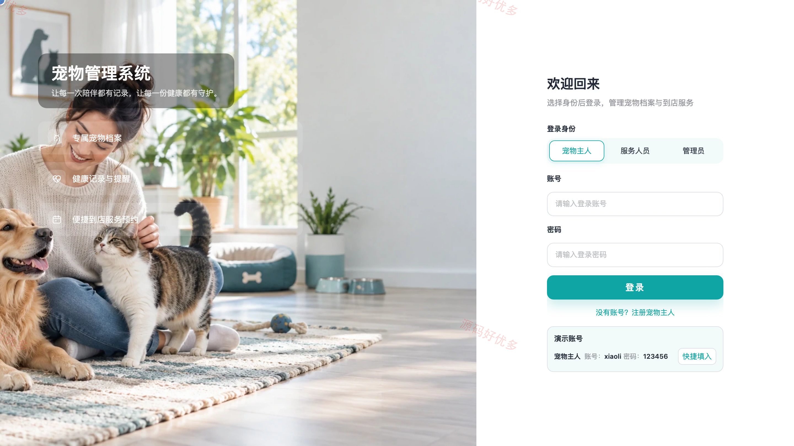
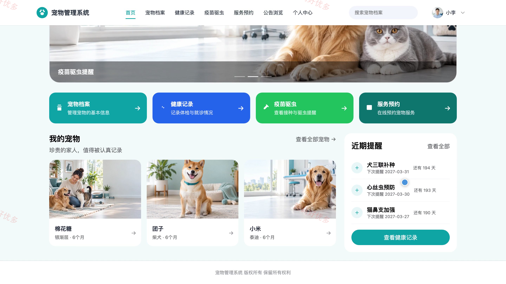
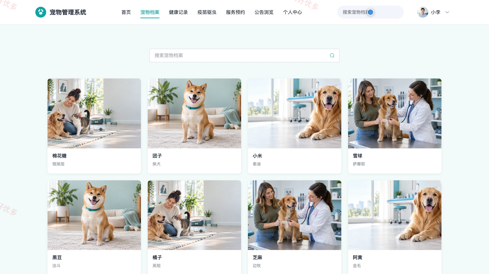
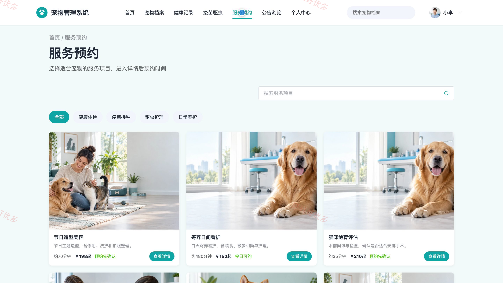
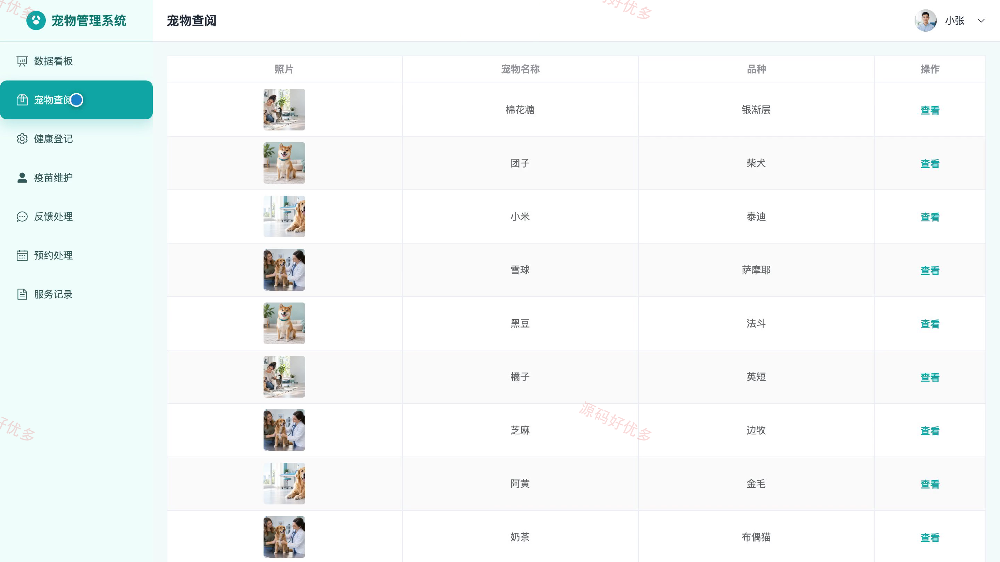
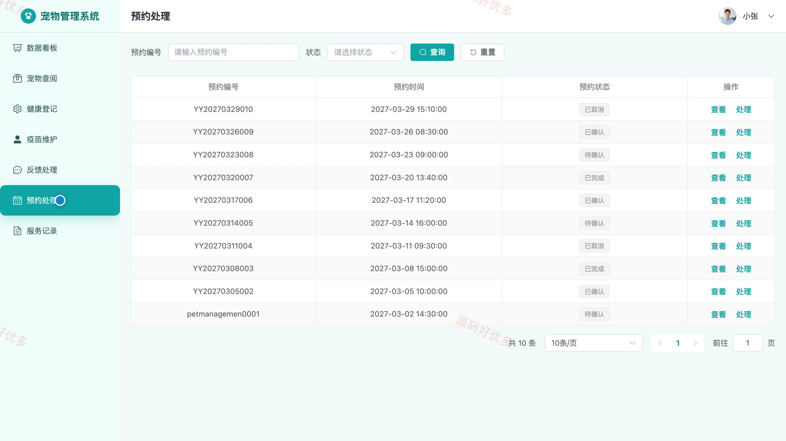
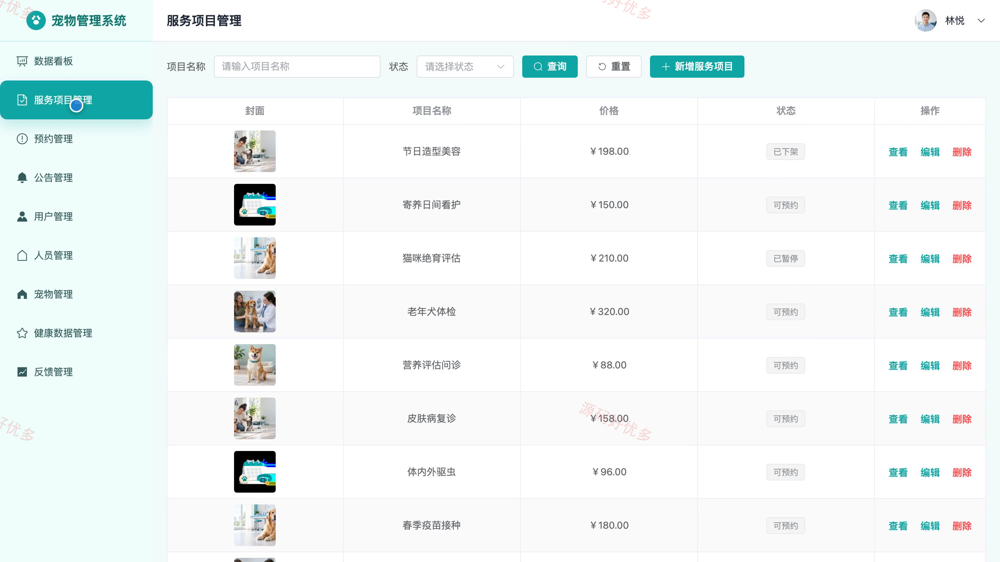
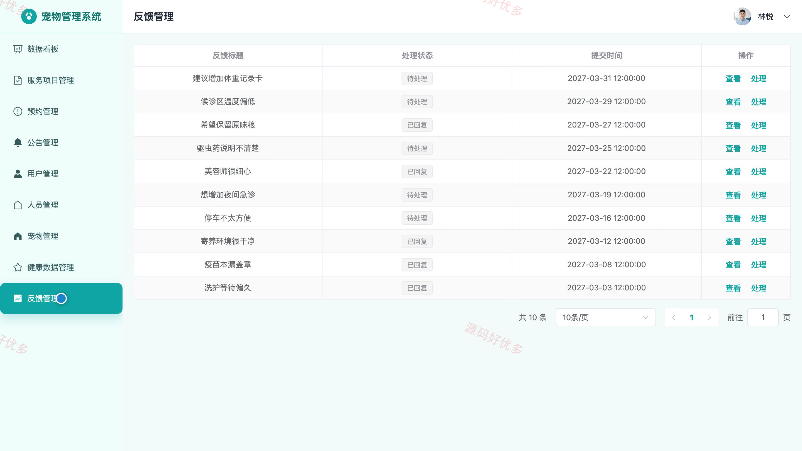

# bs130A
bs130A宠物管理系统源码 Java SpringBoot3 Vue3 前后分离 设计文档 PPT
## 源码问题查看主页咨询

### 一、关键词

宠物档案、健康记录、疫苗驱虫、宠物服务、预约管理、养宠公告

### 二、作品包含

源码+数据库+万字设计文档+PPT+全套环境和工具资源+本地部署教程

### 三、项目技术

前端技术： Html、Css、Js、Vue3.4、Element-Plus
后端技术：Java、SpringBoot3.2.0、MyBatis-Plus

### 四、运行环境要求

开发工具：IDEA/eclipse + VSCODE

数据库：MySQL5.7+（共12张表）

数据库管理工具：Navicat10以上版本

环境配置软件： JDK17 + Maven3.6

前端Nodejs：16+

浏览器：谷歌浏览器

### 五、项目介绍

项目编号：bs130A

宠物管理系统面向宠物主人、服务人员和管理员，围绕宠物档案、健康记录、疫苗驱虫计划、到店服务预约及反馈处理建立协同管理流程，便于持续跟踪宠物健康状态与服务进度。

角色：宠物主人、服务人员、管理员

宠物主人功能：注册登录与个人资料维护、宠物档案维护、健康记录查看、疫苗驱虫计划查看、服务项目浏览、到店服务预约与取消、公告浏览、意见反馈与回复查看。

服务人员功能：工作台数据查看、预约受理与状态处理、宠物档案查阅、服务记录登记、健康记录登记、疫苗驱虫记录维护、用户反馈处理。

管理员功能：宠物主人账号管理、服务人员账号管理、宠物档案管理、服务项目管理、预约进度管理、健康与疫苗数据管理、公告发布管理、反馈监督与数据统计。

### 六、运行截图

